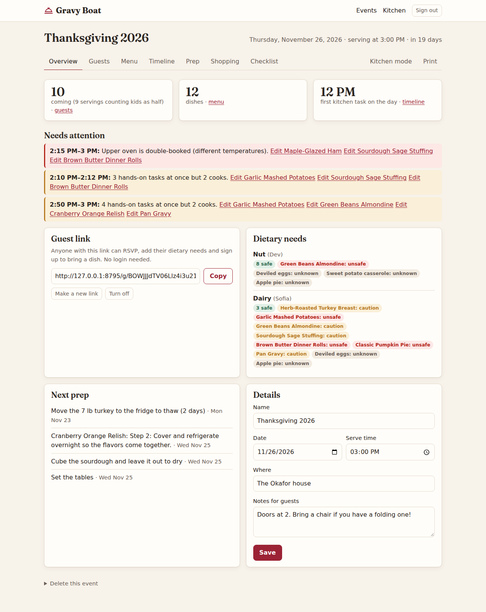
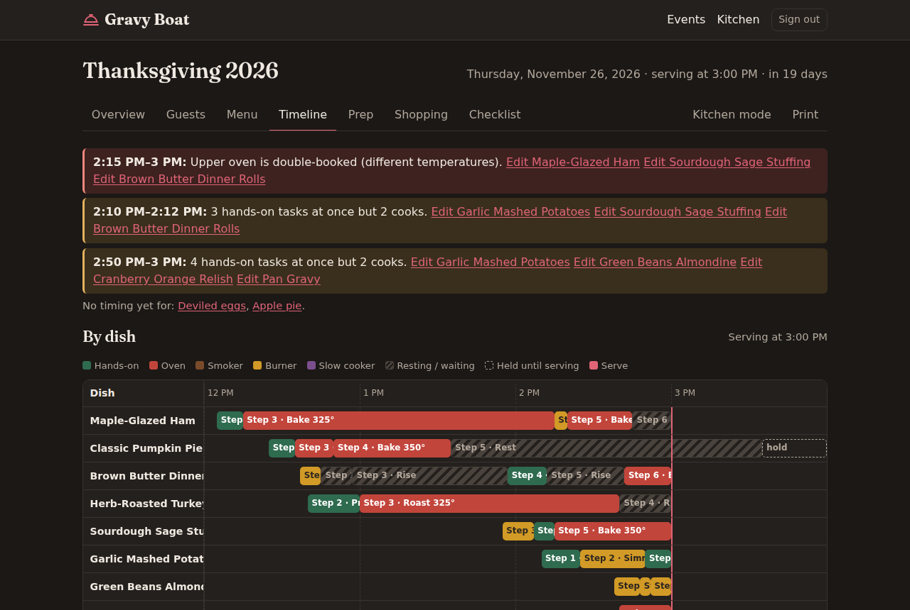
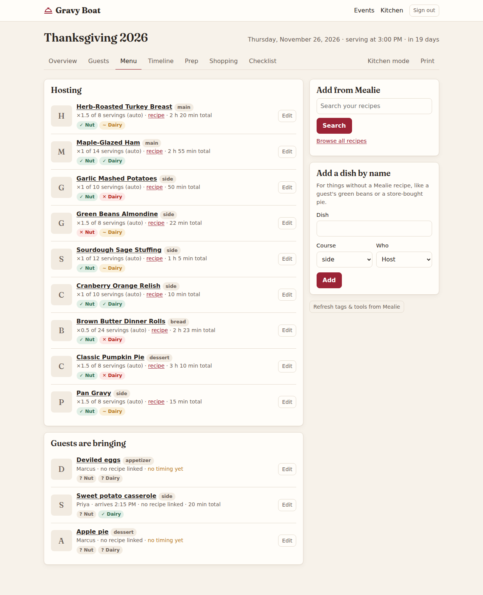
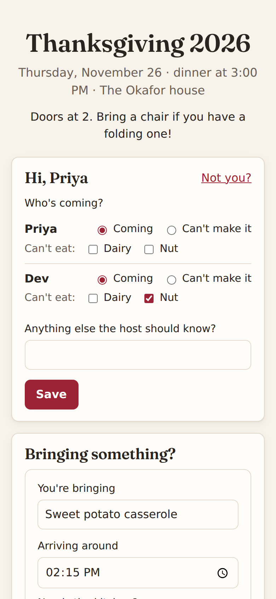
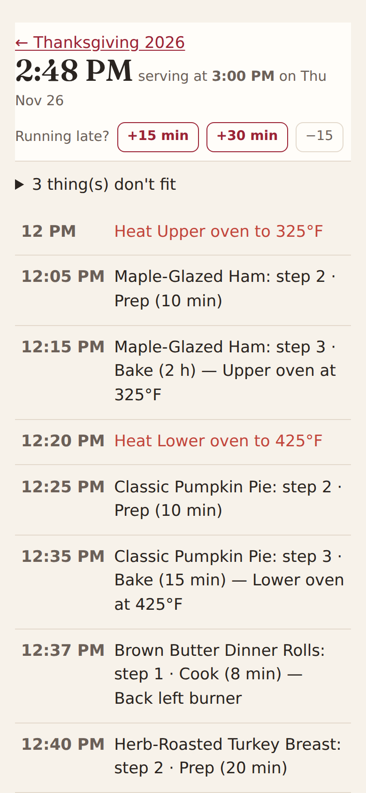

# Gravy Boat

[](https://github.com/Majawat/gravy-boat/actions/workflows/ci.yml)
[](https://github.com/Majawat/gravy-boat/pkgs/container/gravy-boat)
[](LICENSE)

Plan holiday dinners around the recipes in your [Mealie](https://mealie.io) instance.

Gravy Boat keeps everything a big meal needs in one place: who's coming and what they can't eat, who's
bringing what, a cooking timeline that works backward from serving time across the ovens, burners and
smokers you actually have, a prep countdown for the days before, a Mealie shopping list sized to the
headcount, and checklists for the table. Recipes stay in Mealie; Gravy Boat never changes them.



## What it does

- **Guests in groups.** Add households or couples as groups. Each event has a private link where anyone
  in a group can say who's coming, mark dietary needs for each person, claim a dish you still need, or add
  their own. Guests don't need an account and can't add people.
- **Menu from Mealie.** Search your recipes and add them. Dishes guests bring can be typed in by name.
- **Dietary checks from your tags.** Flags like "Nut" or "Dairy" point at Mealie tags (`Nut-Safe`,
  `Dairy-Modifiable`, `Dairy-Unsafe`…), so every dish shows whether it's safe for each person coming.
- **A cooking timeline.** Tell it your kitchen: two ovens, five burners, a smoker, how many dishes fit in
  each. It schedules every step backward from serving time, keeps dishes with similar temperatures sharing
  an oven, allows time to change temperature, adds preheats, and flags clashes and too many hands-on tasks
  at once. Overnight cooks show which day they start.
- **Kitchen mode.** A big-text, step-by-step list for your phone on the day, with "running late" buttons
  that shift everything.
- **Prep countdown.** Tasks by days before (turkey thawing helper included). Recipe steps like
  "refrigerate overnight" are added for you.
- **Shopping list in Mealie.** One button builds the event's list in Mealie with host recipes scaled to
  the headcount (children count half). Updating it later only adjusts what Gravy Boat added.
- **Checklists.** Table and serving ware with counts that follow the headcount, and cookware gathered from
  each recipe's tools.
- **Copy last year.** Start a new event from an old one: guests, menu, timings, prep and checklists.

| Timeline | Menu |
|---|---|
|  |  |

| Guest link (phone) | Kitchen mode (phone) |
|---|---|
|  |  |

More: [dish timing](docs/screenshots/dish.png) · [kitchen setup](docs/screenshots/kitchen.png) ·
[guests](docs/screenshots/guests.png) · [prep](docs/screenshots/prep.png) ·
[shopping](docs/screenshots/shopping.png) · [full timeline](docs/screenshots/timeline.png)

## Requirements

- **Mealie v3.30 or newer.** That's the first version with a time on each recipe step, which the timeline
  is built from. Older versions work, but no recipe will have timing.
- **HTTPS** in front of Gravy Boat (any reverse proxy). Sign-in cookies are Secure.

## Run it

```yaml
# docker-compose.yml
services:
  gravy-boat:
    image: ghcr.io/majawat/gravy-boat:latest
    container_name: gravy-boat
    restart: unless-stopped
    ports:
      - "8794:8794"
    env_file: .env
    volumes:
      - ./data:/data
```

```sh
cp .env.example .env     # set GRAVYBOAT_SECRET_KEY and MEALIE_URL
docker compose up -d
```

Then open it through your reverse proxy and sign in with your Mealie account.

### Settings

| Variable | Default | |
|---|---|---|
| `GRAVYBOAT_SECRET_KEY` | (required) | Signs session cookies. `python -c "import secrets; print(secrets.token_hex(32))"` |
| `MEALIE_URL` | `http://mealie:9000` | How the server reaches Mealie. |
| `MEALIE_PUBLIC_URL` | `MEALIE_URL` | How browsers reach Mealie, for recipe links and photos. |
| `GRAVYBOAT_TRUSTED_PROXIES` | `1` | Reverse proxies in front of it. `0` if browsers connect directly. |
| `GRAVYBOAT_INSECURE_COOKIES` | unset | `1` allows sign-in over plain http. LAN testing only. |
| `GRAVYBOAT_DATABASE_URL` | `sqlite:////data/gravyboat.db` | |
| `TZ` | UTC | Your time zone, so "today" and the clock are right. |

The container runs as uid/gid 1000. To own the data folder as someone else, add `user: "UID:GID"` to the
service (on Unraid, `"99:100"`).

## Accounts and privacy

- There are no Gravy Boat accounts. Hosts sign in with their Mealie username and password, or with a
  Mealie API token (for accounts that use single sign-on). Everything is shared within your Mealie
  household.
- Guests only ever see their event's page. Anyone with the link can pick any name on it, so treat the
  link like a party invitation; you can turn it off or replace it at any time.
- Gravy Boat reads recipes and writes only shopping lists to Mealie. Pages load nothing from third
  parties.

## How timing works

Each Mealie recipe step that has a time becomes a step in the timeline, with Mealie's minutes. Steps without
a time are left out (and you're told how many). Mealie can't store which appliance a step uses or how hot
yet, so Gravy Boat suggests those from the step's text, and whatever you set is remembered for that recipe.

When a recipe gives a range ("8 to 10 minutes"), put the longest time in Mealie's step time. The timeline
then never runs late; a dish that finishes early just waits.

## Development

See [docs/DEVELOPMENT.md](docs/DEVELOPMENT.md) and [CONTRIBUTING.md](CONTRIBUTING.md).
Security problems: see [SECURITY.md](SECURITY.md).

## License

MIT. The bundled Fraunces font is under the SIL Open Font License (`app/static/fonts/OFL.txt`).
